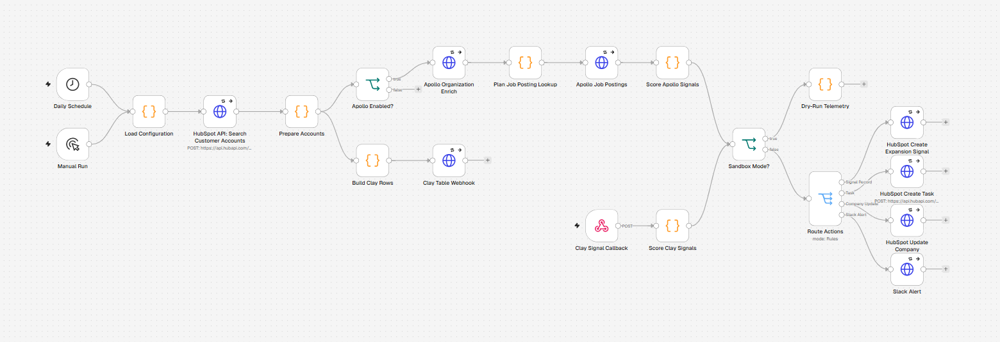
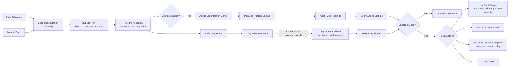

# n8n-clay-apollo-account-expansion-radar

A scheduled n8n workflow that watches your **existing HubSpot customers** for expansion trigger events (**funding rounds**, **executive hiring spikes**, **new technology adoption** and **headcount growth**) using Apollo and Clay. It turns them into scored, auditable actions: **Expansion Signal custom-object records**, **rep tasks**, an **upsell-play handoff** that your HubSpot workflow uses to enrol accounts into upsell sequences, and **Slack alerts**.


> **Safe by default.** `SANDBOX_MODE=true` runs the full detection and scoring pipeline but only logs what it *would* write. The radar never sends email itself.

---

## Table of contents

1. [Architecture overview](#architecture-overview)
2. [Node breakdown](#node-breakdown)
3. [Signals and scoring](#signals-and-scoring)
4. [Repository layout](#repository-layout)
5. [Setup guide](#setup-guide)
6. [Environment variables](#environment-variables)
7. [Deployment steps](#deployment-steps)
8. [Testing and security scan](#testing-and-security-scan)
9. [Operations and troubleshooting](#operations-and-troubleshooting)
10. [Disclaimer](#️-disclaimer--liability-limitation)
11. [License](#license)

---

## Architecture overview





**Two signal paths, one decision engine.**

- **Apollo (synchronous).** On each scheduled run, the least recently checked customer accounts are enriched through Apollo's organization enrichment and job-postings endpoints. Changes are measured against a snapshot stored on the company (technologies, headcount).
- **Clay (asynchronous).** Clay has no synchronous lookup API: integrations run through table webhooks and HTTP API columns. When `ENABLE_CLAY_PUSH=true`, the radar pushes each scanned account into a Clay table. Your Clay table enriches it (news, hiring, intent, or any Clay source) and an **HTTP API column** posts the results back to the radar's **Clay Signal Callback** webhook, authenticated with a shared secret.

Both paths feed the same engine (`src/radarEngine.js`), which scores signals, applies thresholds and cooldowns, and emits typed action items. `npm run build` compiles the engine into the workflow's Code nodes, so what runs in n8n is exactly what the tests cover.

**Upsell sequence enrolment is a handoff, not a send.** When an account's score crosses `PLAY_SCORE_THRESHOLD`, the radar sets the company property `expansion_radar_play` (e.g. `expansion_upsell`). A HubSpot workflow that you own enrols the right contacts into your upsell sequence. Sending, opt-outs, sender selection and approvals stay inside HubSpot's governance.

---

## Node breakdown

| # | Node | Type | Purpose |
| --- | --- | --- | --- |
| 1 | Daily Schedule | Schedule Trigger | Runs daily at 06:00. Each run scans up to `MAX_ACCOUNTS_PER_RUN` accounts not checked in `RECHECK_DAYS`, oldest first. |
| 2 | Manual Run | Manual Trigger | On-demand runs and testing. |
| 3 | Load Configuration | Code | Validates every setting (fail fast) and builds the company search body. |
| 4 | HubSpot API: Search Customer Accounts | HTTP Request (HubSpot credential) | `POST /crm/v3/objects/companies/search` for `lifecyclestage = TARGET_LIFECYCLE_STAGE`, paginated, least recently checked first. |
| 5 | Prepare Accounts | Code | Normalizes domains, de-duplicates, applies the re-check cadence and run cap. Ends cleanly if nothing is due. |
| 6 | Apollo Enabled? | IF | Skips the Apollo path when `ENABLE_APOLLO=false`. |
| 7 | Apollo Organization Enrich | HTTP Request (Header Auth `x-api-key`) | `GET https://api.apollo.io/api/v1/organizations/enrich?domain=…`, paced under 1 request per second. |
| 8 | Plan Job Posting Lookup | Code (each item) | Builds the job-postings URL only when Apollo returned an organization ID and postings are enabled. |
| 9 | Apollo Job Postings | HTTP Request | `GET /api/v1/organizations/{id}/job_postings`. Skipped lookups (null URL) fail locally without a network call and are ignored. |
| 10 | Score Apollo Signals | Code | Detects FUNDING, EXEC_HIRING_SPIKE, TECH_ADOPTION and HEADCOUNT_GROWTH, scores accounts and plans actions. |
| 11 | Build Clay Rows | Code | Emits one row per account when `ENABLE_CLAY_PUSH=true` and not in sandbox. |
| 12 | Clay Table Webhook | HTTP Request | `POST` to `CLAY_TABLE_WEBHOOK_URL`, 5 per second. |
| 13 | Clay Signal Callback | Webhook | `POST /webhook/expansion-radar/clay-signals`; responds immediately. |
| 14 | Score Clay Signals | Code | Verifies `x-radar-secret` (constant-time), maps Clay signals, scores and plans actions. |
| 15 | Sandbox Mode? | IF | `true` → Dry-Run Telemetry; `false` → Route Actions. |
| 16 | Dry-Run Telemetry | Code | Logs every planned record, task, update and alert. |
| 17 | Route Actions | Switch | Routes `signal_record`, `task_create`, `company_update`, `slack_alert`; `run_summary` is dropped. |
| 18 | HubSpot Create Expansion Signal | HTTP Request | `POST /crm/v3/objects/{EXPANSION_SIGNAL_OBJECT_TYPE}` with an association to the company. |
| 19 | HubSpot Create Task | HTTP Request | `POST /crm/v3/objects/tasks` for the account owner (or `FALLBACK_OWNER_ID`). |
| 20 | HubSpot Update Company | HTTP Request | `PATCH /crm/v3/objects/companies/{id}`: snapshot, score, last checked / last signal, play handoff. |
| 21 | Slack Alert | HTTP Request | Posts a Block Kit digest to `SLACK_WEBHOOK_URL` (Incoming Webhook). |

Every HTTP node retries 3 times and continues on error, so one failing account never blocks the rest. Run status is reported as `OK`, `PARTIAL_ERRORS`, `PARTIAL_RATE_LIMITED` or `ENGINE_ERROR`.

---

## Signals and scoring

| Signal | Source | Rule (defaults) | Weight |
| --- | --- | --- | --- |
| `FUNDING` | Apollo `funding_events` | Round dated within `FUNDING_LOOKBACK_DAYS` (90) | 40, ×1.25 for rounds ≥ 50M |
| `EXEC_HIRING_SPIKE` | Apollo job postings | ≥ `EXEC_HIRING_THRESHOLD` (3) postings in `HIRING_LOOKBACK_DAYS` (30) whose title contains an `EXEC_TITLE_KEYWORDS` word (chief, vp, head of, director…) | 30, +10 % per extra role (max +50 %) |
| `TECH_ADOPTION` | Apollo `current_technologies` | Technologies on `TECH_WATCHLIST` that were not in the stored snapshot | 25 (60 % if the watchlist is empty) |
| `HEADCOUNT_GROWTH` | Apollo `estimated_num_employees` | Growth ≥ `HEADCOUNT_GROWTH_PCT` (15 %) versus the stored snapshot | 15, ×1.5 at twice the threshold |
| `CLAY_SIGNAL` (or any type above) | Clay callback | Each signal in the callback; `weight` optional | 20 or the type's weight |

**First run = baseline.** If a company has no snapshot yet, technology and headcount changes are not flagged. The current values are stored, so later runs only report genuine changes.

**Score.** The strongest signal counts in full and every other signal at 50 %, capped at 100 (for example 50 + ½ × 33 = 67).

| Score | Action |
| --- | --- |
| any signal | One **Expansion Signal** record per signal (if `ENABLE_SIGNAL_RECORDS=true`) |
| ≥ `TASK_SCORE_THRESHOLD` (40) | **Task** for the account owner, unless the account had a signal within `SIGNAL_COOLDOWN_DAYS` (30) |
| ≥ `PLAY_SCORE_THRESHOLD` (60) | **Play handoff**: `expansion_radar_play = EXPANSION_PLAY_VALUE` (if not already set) |
| task or play | Account included in the **Slack** digest |

**Idempotency.** Each record carries a `signal_key` (`<companyId>:<type>:<period>`). Make it a **unique-value** property and HubSpot will reject duplicates (HTTP 409), so re-runs never double-count a signal.

---

## Repository layout

```
n8n-clay-apollo-account-expansion-radar/
├── .github/workflows/ci.yml      # lint, build check, tests + security scan (Node 20 & 22)
├── scripts/build-workflow.js     # compiles src/ into workflow.json
├── src/
│   ├── config.js                 # env parsing and fail-fast validation
│   └── radarEngine.js            # accounts, Apollo/Clay signals, scoring, payloads
├── test/
│   ├── fixtures/                 # synthetic HubSpot, Apollo and Clay payloads
│   ├── radarEngine.test.js       # unit tests
│   └── workflow.test.js          # workflow structure, Code node execution, security scan
├── workflow.json                 # importable n8n workflow (generated)
├── .env.example                  # configuration template (SANDBOX_MODE=true)
├── .gitignore
├── DISCLAIMER.md
├── LICENSE
├── package.json                  # zero runtime dependencies
└── README.md
```

---

## Setup guide

### 1. HubSpot

**Private app** (*Settings → Integrations → Private Apps*). Grant the minimum scopes your portal lists for:

- companies: read and write (`crm.objects.companies.read`, `crm.objects.companies.write`);
- custom objects: read and write (`crm.objects.custom.read`, `crm.objects.custom.write`) plus `crm.schemas.custom.read`;
- tasks: the scope HubSpot shows for creating tasks / engagements in your portal.

Save the token in an n8n **HubSpot App Token** credential (`REPLACE_WITH_HUBSPOT_PAT`) and select it on the four HubSpot nodes.

**Company properties** (*Settings → Properties → Company*):

| Internal name | Type |
| --- | --- |
| `expansion_radar_last_checked_at` | Date and time |
| `expansion_radar_last_signal_at` | Date and time |
| `expansion_radar_score` | Number |
| `expansion_radar_play` | Dropdown (include the option `expansion_upsell`, or your `EXPANSION_PLAY_VALUE`) |
| `expansion_radar_tech_snapshot` | Multi-line text |
| `expansion_radar_headcount_snapshot` | Number |

**Expansion Signal custom object** (Enterprise tier; *Settings → Data Management → Objects → Custom Objects*, or the schemas API). Create the object with these properties:

| Property | Type | Notes |
| --- | --- | --- |
| `signal_key` | Single-line text | **Unique value**; also the primary display property |
| `signal_type` | Dropdown | `FUNDING`, `EXEC_HIRING_SPIKE`, `TECH_ADOPTION`, `HEADCOUNT_GROWTH`, `CLAY_SIGNAL` |
| `signal_title` | Single-line text | |
| `signal_detail` | Multi-line text | |
| `signal_source` | Dropdown | `apollo`, `clay` |
| `signal_weight`, `account_score` | Number | |
| `occurred_at` | Date and time | |
| `source_url` | Single-line text | |

Then set `EXPANSION_SIGNAL_OBJECT_TYPE` to its `objectTypeId` (`2-…`) or fully qualified name (`p<portalId>_…`). Find the **Expansion Signal → Company association type ID** with `GET /crm/v4/associations/{objectType}/companies/labels` and set `SIGNAL_COMPANY_ASSOCIATION_TYPE_ID`. Task → Company uses the HubSpot-defined ID `192` by default; confirm it in HubSpot's association reference for your portal.

**Upsell play workflow.** In HubSpot, create a workflow triggered when `expansion_radar_play` is `expansion_upsell`. Use it to enrol the right contacts (for example the account's champion or economic buyer) into your upsell sequence, notify the owner, or create a deal. Sequence enrolment needs a Sales Hub seat and a contact-based step, so keep human review in that workflow if your process requires it.

### 2. Apollo

Create an Apollo API key with access to organization enrichment and job postings (endpoint access depends on your Apollo plan). In n8n, create a **Header Auth** credential named `x-api-key` with value `REPLACE_WITH_APOLLO_API_KEY`, and select it on both Apollo nodes. Each enrichment consumes Apollo credits: keep `MAX_ACCOUNTS_PER_RUN` and `RECHECK_DAYS` in line with your budget.

### 3. Clay (optional)

1. Create a Clay table with a **Webhook** source. Copy its URL into `CLAY_TABLE_WEBHOOK_URL`. If your webhook source requires an auth token, add a Header Auth credential (`REPLACE_WITH_CLAY_API_KEY`) to the *Clay Table Webhook* node.
2. Add the enrichment columns you want (news, funding, hiring, intent, technographics).
3. Add an **HTTP API** column that `POST`s to your n8n production URL `https://<your-n8n-host>/webhook/expansion-radar/clay-signals`, with header `x-radar-secret: <RADAR_WEBHOOK_SECRET>` and this body:

```json
{
  "hubspot_company_id": "/hubspot_company_id",
  "domain": "/domain",
  "company_name": "/company_name",
  "owner_id": "/owner_id",
  "last_signal_at": "/last_signal_at",
  "current_play": "/current_play",
  "signals": [
    {
      "type": "EXEC_HIRING_SPIKE",
      "title": "New Chief Data Officer appointed",
      "occurred_at": "2026-05-28",
      "source_url": "https://news.example-corp.com/cdo",
      "detail": "Short evidence text",
      "weight": 30
    }
  ]
}
```

`type` may be any radar signal type; anything else becomes `CLAY_SIGNAL`. Up to 25 signals per callback. Echoing `last_signal_at` and `current_play` back lets the cooldown and play rules work for Clay signals too.

### 4. Slack

Create a Slack app with an **Incoming Webhook** for your expansion channel and put its URL in `SLACK_WEBHOOK_URL` (`REPLACE_WITH_SLACK_WEBHOOK_URL` in the template).

---

## Environment variables

Load `.env` into the n8n process and set `N8N_BLOCK_ENV_ACCESS_IN_NODE=false`. API keys belong in n8n credentials, not in `.env`. Webhook URLs are read only by the HTTP nodes at runtime; the Code nodes only check that they are set.

| Variable | Default | Description |
| --- | --- | --- |
| `SANDBOX_MODE` | `true` | `true` = log only. `false` = write to HubSpot, push to Clay, post to Slack. |
| `AS_OF_DATE` | *(now)* | Fixed "now" for reproducible dry runs. |
| `HUBSPOT_PORTAL_ID` | *(blank)* | Numeric portal ID for HubSpot links in Slack. |
| `HUBSPOT_APP_BASE_URL` | `https://app.hubspot.com` | Link base URL. |
| `TARGET_LIFECYCLE_STAGE` | `customer` | Lifecycle stage of accounts to scan. |
| `MAX_ACCOUNTS_PER_RUN` | `100` | Accounts scanned per run (1–5000). |
| `RECHECK_DAYS` | `7` | Minimum days between scans of the same account. |
| `EXPANSION_SIGNAL_OBJECT_TYPE` | `REPLACE_WITH_EXPANSION_SIGNAL_OBJECT_TYPE_ID` | `2-…` or `p<portal>_…`. Required live when records are on. |
| `SIGNAL_COMPANY_ASSOCIATION_TYPE_ID` | `REPLACE_WITH_SIGNAL_COMPANY_ASSOCIATION_TYPE_ID` | Expansion Signal → Company association type. |
| `TASK_COMPANY_ASSOCIATION_TYPE_ID` | `192` | Task → Company association type. |
| `FALLBACK_OWNER_ID` | *(blank)* | Task owner for unowned companies. |
| `ENABLE_APOLLO` | `true` | Apollo signal path. |
| `ENABLE_APOLLO_JOB_POSTINGS` | `true` | Executive hiring detection (one extra Apollo call per account). |
| `ENABLE_CLAY_PUSH` | `false` | Push accounts to the Clay table (live mode only). |
| `CLAY_TABLE_WEBHOOK_URL` | `REPLACE_WITH_CLAY_TABLE_WEBHOOK_URL` | Clay table webhook URL. |
| `RADAR_WEBHOOK_SECRET` | `REPLACE_WITH_RADAR_WEBHOOK_SECRET` | Shared secret for Clay callbacks (min 16 chars). Required live. |
| `FUNDING_LOOKBACK_DAYS` | `90` | Funding recency window. |
| `HIRING_LOOKBACK_DAYS` | `30` | Job-posting recency window. |
| `EXEC_HIRING_THRESHOLD` | `3` | Executive postings needed for a spike. |
| `EXEC_TITLE_KEYWORDS` | `chief,vp,vice president,head of,director,…` | Whole-word title keywords. |
| `TECH_WATCHLIST` | *(blank)* | Technologies that indicate expansion potential. |
| `HEADCOUNT_GROWTH_PCT` | `15` | Growth % that counts as a signal. |
| `WEIGHT_FUNDING` / `WEIGHT_EXEC_HIRING` / `WEIGHT_TECH_ADOPTION` / `WEIGHT_HEADCOUNT_GROWTH` / `WEIGHT_CLAY_SIGNAL` | `40` / `30` / `25` / `15` / `20` | Signal weights (0–100). |
| `TASK_SCORE_THRESHOLD` | `40` | Score for a rep task. |
| `PLAY_SCORE_THRESHOLD` | `60` | Score for the upsell-play handoff. |
| `SIGNAL_COOLDOWN_DAYS` | `30` | No new task within this window of the last signal. |
| `TASK_DUE_DAYS` | `3` | Task due date offset. |
| `ENABLE_SIGNAL_RECORDS` / `ENABLE_TASKS` / `ENABLE_PLAY_HANDOFF` / `ENABLE_SLACK` | `true` | Toggle each action. |
| `EXPANSION_PLAY_VALUE` | `expansion_upsell` | Value written to `expansion_radar_play`. |
| `SLACK_WEBHOOK_URL` | `REPLACE_WITH_SLACK_WEBHOOK_URL` | Slack Incoming Webhook URL. Required live when Slack is on. |

Validation is fail-fast: invalid numbers, malformed IDs, short secrets and (in live mode) missing object types, association IDs, secrets or webhook URLs stop the run before any API call, with every problem listed together. `REPLACE_WITH_…`, `{{…}}` and `your-…` values count as unset.

---

## Deployment steps

1. **Validate locally (optional):** `git clone`, then `npm test`. No install is needed; Node.js ≥ 20 only.
2. **Configure:** `cp .env.example .env`, replace the `REPLACE_WITH_…` values, keep `SANDBOX_MODE=true`, load `.env` into n8n with `N8N_BLOCK_ENV_ACCESS_IN_NODE=false`, and restart n8n.
3. **Prepare HubSpot** in a sandbox or developer test portal: private app, company properties, the Expansion Signal object, its association type, and the upsell-play workflow (inactive at first).
4. **Import** `workflow.json` (*Workflows → Import from File*). It imports **inactive**. Select credentials on the HubSpot and Apollo nodes (and Clay if needed).
5. **Dry run:** *Manual Run → Execute workflow*. Review **Dry-Run Telemetry** (`lines` and `planned`): which accounts fired, with which signals and scores.
6. **Tune** the watchlist, keywords, weights and thresholds until the alerts match what your account managers consider real expansion moments.
7. **Go live in stages:** set `SANDBOX_MODE=false` with only `ENABLE_SIGNAL_RECORDS=true` first, then tasks, then Slack, then the play handoff, and finally activate the HubSpot upsell workflow.
8. **Activate** the n8n workflow (daily schedule and Clay webhook), set an **Error Workflow**, and point the Clay HTTP API column at the production webhook URL.

To change logic, edit `src/`, run `npm test` and `npm run build`, and re-import `workflow.json`.

---

## Testing and security scan

| Command | What it does |
| --- | --- |
| `npm test` | Unit tests plus workflow tests (Node.js built-in test runner; no Jest install needed). |
| `npm run test:security` | Runs only the repository security scan. |
| `npm run build` / `npm run build:check` | Regenerates or verifies `workflow.json`. |
| `npm run ci` | Lint, build check and tests (what CI runs). |

`test/workflow.test.js`:

1. **Structure:** `workflow.json` parses, matches a fresh build of `src/`, imports inactive, has every required node with the right type, unique IDs, valid connections and the expected routing.
2. **Execution:** every Code node runs in an isolated VM that mimics n8n (`$input`, `$json`, `$env`, `$().itemMatching()`), replaying the workflow against synthetic fixtures. Coverage includes the sandbox and live paths, Apollo 404 and 429 responses, the first-run baseline, cooldown, the Clay secret check, and empty or failed searches.
3. **Security scan:** fails if any file contains a live-looking HubSpot, Slack, Clay, AWS or Google token, a bearer token, a private key, a non-placeholder Apollo key, or an email address outside reserved example domains. It also checks that credential slots in `workflow.json` are `REPLACE_WITH_…` placeholders.

All fixtures are synthetic (for example *Synthetic Company Alpha*, `example-corp.com`, `*.example` domains).

---

## Operations and troubleshooting

| Symptom | Likely cause |
| --- | --- |
| Everything ends in *Dry-Run Telemetry* | `SANDBOX_MODE` is still `true`, or env access is blocked. |
| `Invalid expansion radar configuration` | Read the listed problems; each names its variable. |
| No accounts scanned | All accounts checked within `RECHECK_DAYS`, wrong `TARGET_LIFECYCLE_STAGE`, or companies lack a domain. |
| Status `PARTIAL_RATE_LIMITED` | Apollo returned 429; lower `MAX_ACCOUNTS_PER_RUN` or increase pacing on the Apollo nodes. |
| No TECH or HEADCOUNT signals on day one | Expected: the first scan stores the baseline snapshot. |
| Expansion Signal create returns 409 | Duplicate `signal_key`: the signal was already recorded (expected on re-runs). |
| Expansion Signal create returns 400 | Object type, property names or association type ID do not match your portal. |
| Clay callbacks ignored | Missing or wrong `x-radar-secret` header (`WEBHOOK_SECRET_MISMATCH` in the log), or `hubspot_company_id` not sent. |
| No Slack alert | No account crossed a task or play threshold, or `SLACK_WEBHOOK_URL` is unset. |

---

## ⚠️ Disclaimer & Liability Limitation

Use at your own risk. The code, workflows, and scripts provided in this repository (`n8n-clay-apollo-account-expansion-radar`) are for educational and architectural demonstration purposes.

* **No Liability:** The author and dhRobin Systems assume no responsibility or liability for any direct, indirect, incidental, or consequential damages resulting from the use, misuse, or deployment of these scripts.
* **No Warranty:** All software, n8n JSON blueprints, and JavaScript modules are provided "AS IS" without warranty of any kind, express or implied, including but not limited to merchantability, fitness for a particular purpose, or non-infringement.
* **Production Testing Required:** Always test thoroughly in an isolated staging environment (for example a HubSpot developer test account or sandbox) with `SANDBOX_MODE=true` enabled before connecting live HubSpot credentials.
* **Third-Party APIs & Compliance:** Users are solely responsible for complying with the terms of service, rate limits, data privacy regulations (GDPR/CCPA), anti-spam laws (e.g. CAN-SPAM, CASL, PECR), and security policies of HubSpot, Apollo, Clay, Slack and any connected services, including honouring every unsubscribe request and reviewing every automated task, property change and sequence enrollment.

The full disclaimer is also available in [DISCLAIMER.md](https://github.com/dhrobinsystems/n8n-clay-apollo-account-expansion-radar/blob/main/DISCLAIMER.md).

## License

Released under the MIT License. Copyright (c) 2026 DH Robin (dhRobin Systems). See [LICENSE](https://github.com/dhrobinsystems/n8n-clay-apollo-account-expansion-radar/blob/main/LICENSE).
